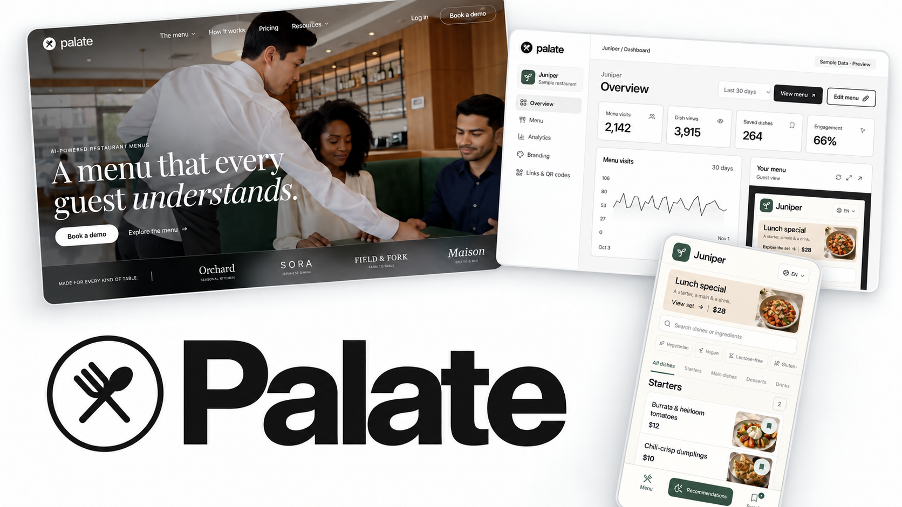

<div align="center">

# Palate

### A menu that every guest understands.

Visual restaurant menus. Simple management. One place for every restaurant.

[Features](#what-palate-does) · [Run locally](#run-locally) · [Deploy to Vercel](#deploy-to-vercel) · [Setup guide](VERCEL-SETUP.md)

</div>



<p align="center"><sub>Homepage · Restaurant dashboard · Mobile menu — an AI-assisted product visual.</sub></p>

Palate helps restaurant guests see their options and choose what to order. Guests open a menu from a link or QR code, explore dish photos and ingredients, filter by dietary preferences, and find suggestions that fit their meal. Restaurant owners manage the content from their own dashboard, while the Palate team handles setup and access.

## What Palate does

| For guests | For restaurant owners | For the Palate team |
| --- | --- | --- |
| Photo menus with clear dish details | Edit dishes, prices, ingredients, and photos | Create and brand restaurant workspaces |
| Dietary filters and saved dishes | Manage categories, availability, and specials | Review demo requests and activate accounts |
| Menu languages and meal suggestions | Review menu visits and dish engagement | Manage staff and restaurant access |
| Mobile bottom sheets and desktop detail panels | Share menu links and download QR codes | Respond to support requests |

Each restaurant has its own menu, branding, team, and data. Access is enforced in Supabase, not just hidden in the interface.

Palate helps guests choose their meal; it does **not** process diner orders, take payments, or replace a restaurant’s POS. Analytics measure menu interactions, not sales revenue.

## Run locally

**Requirements:** Node.js 22, npm, and Python 3. The Node version is also recorded in `.nvmrc`.

```sh
git clone https://github.com/VarunKurra/Palate---AI-Menus.git
cd Palate---AI-Menus
npm run install:apps
npm run build
npm start
```

Open **[localhost:8942](http://127.0.0.1:8942/)**.

| Page | Local address |
| --- | --- |
| Homepage | [Open homepage](http://127.0.0.1:8942/) |
| Sample guest menu | [Explore the menu](http://127.0.0.1:8942/menu/) |
| Sample owner dashboard | [Preview the dashboard](http://127.0.0.1:8942/dashboard/?preview=1) |
| Restaurant sign-in | [Sign in](http://127.0.0.1:8942/login/) |
| Palate staff workspace | [Staff sign-in](http://127.0.0.1:8942/admin/) |

The sample menu and dashboard preview can be explored without an account. Real workspaces require authorized access. The local server serves `dist/`; run `npm run build` again after changing source files.

## Deploy to Vercel

Import this repository into Vercel with the **repository root** as Root Directory and **Other** as Framework Preset. The included `vercel.json` supplies the build settings:

| Setting | Value |
| --- | --- |
| Node.js | `22.x` |
| Install command | `npm run install:apps` |
| Build command | `npm run build:vercel` |
| Output directory | `dist` |

The build runs automated tests, compiles both applications, and checks the output for missing routes, broken local assets, favicon files, and accidentally included private files. GitHub Actions runs the same checks on pushes and pull requests. After connecting the repository, Vercel can deploy updates from your production branch.

**After Vercel assigns a URL, follow [the deployment guide](VERCEL-SETUP.md)** to configure Supabase redirects, allowed origins, and account-recovery email. Use the final public address before printing restaurant QR codes.

Vercel hosts the frontend. Supabase continues to host authentication, the database, image storage, and server functions. A Vercel deployment does not apply database migrations or deploy Supabase functions.

## Connections and launch status

| Connection | Current behavior |
| --- | --- |
| Supabase | Configured for Palate’s existing project with a publishable browser key. |
| Recommendations | Rule-based suggestions work; live AI requires a provider key in Supabase. |
| Languages | The sample menu includes 80 languages. Each restaurant publishes its own reviewed translations; automatic translation requires the AI connection. |
| Invitations | Private, single-use links expire after seven days and require the matching account email. Share them directly with the intended recipient. |
| Account recovery | Configure a verified SMTP sender and production redirects before onboarding customers. |
| Payments and agreements | Not connected. Handle billing and service agreements separately. |

Signup does not require email confirmation, but an email match alone never grants restaurant or staff access. Existing users gain access through a private invitation or an explicit staff approval of a known owner’s demo request.

No Vercel environment variables are required for the current frontend. Keep database passwords, service-role keys, and AI keys out of frontend code and Git. Server-only settings are described in [`.env.example`](.env.example).

## Project structure

```text
index.html                 Marketing homepage
styles.css                 Homepage styling
script.js                  Homepage interactions
homepage-motion.js         Scroll and reveal effects
assets/                    Brand assets, fonts, photos, video, and favicons
platform/src/              Public pages, authentication, owner and staff apps
menu/src/                  Guest menu interface and meal-selection logic
supabase/migrations/       Versioned database schema and access policies
supabase/functions/        Recommendation and translation services
supabase/tests/            Database access-control checks
scripts/                   Public packaging and release checks
.github/workflows/         Automated build checks
vercel.json                Vercel build, routing, and security headers
```

Built with React, Radix UI, Lucide, esbuild, and Supabase. The marketing homepage uses HTML, CSS, and JavaScript. Generated bundles and `dist/` are rebuilt from source and excluded from Git.

## Check a change

```sh
# Unit tests, production build, and release checks
npm run build:vercel
```

For maintainers with authorized Supabase access, run the database checks **sequentially** against the linked Palate project:

```sh
supabase db query --linked --file supabase/tests/tenant_access.sql
supabase db query --linked --file supabase/tests/secure_invitations.sql
```

These checks use temporary fixtures, roll back their changes, and send no emails. They cover restaurant isolation, permission boundaries, public menu access, and invitation validation.

See [VERCEL-SETUP.md](VERCEL-SETUP.md) for deployment and launch checks, or [PLATFORM-GUIDE.txt](PLATFORM-GUIDE.txt) for the staff workflow and backend details. Do not reset or recreate the existing production database when deploying frontend changes.

## License

[MIT](LICENSE) · Copyright © 2026 Varun Kurra.
